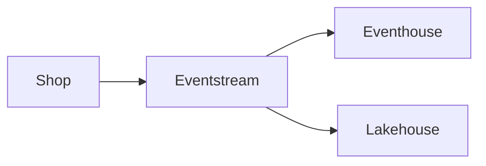

---
tags:
  - dp700
  - study
  - flashcards/dp700
---
# Eventstream and eventhouse

> [!tip] Do this
> Watch the video on real-time intelligence, then do the lab.
> Answer the quick check before you open the answer.

## Tasks

- [ ] Read §1 and answer the quick check
- [ ] Do the code drill in §2
- [ ] Teach the topic back in your own words

## Glossary

- **Eventstream**: routes events from a source to several destinations in flight.
- **Eventhouse**: stores streaming data and lets you query it.
- **KQL**: the query language of an eventhouse.

## §1 Route events in flight

A shop sends click events to an eventstream.
The eventstream sends each event to an eventhouse and to a lakehouse at the same time.

> **Quick check:** Which item sends one stream to several destinations?
> A. Eventhouse
> B. Eventstream
> C. Lakehouse
> D. Notebook

> [!question]- Answer
> **Answer: B** The eventstream routes events in flight.

## §2 Query the events

The eventhouse keeps every event, so you can query the history with KQL.



> [!example]- Code drill (KQL)
> Complete the query so it counts events per device.
> ```kql
> Events
> | summarize count() by ____
> ```
> > [!example]- Solution
> > ```kql
> > Events
> > | summarize count() by DeviceId
> > ```

## Teach it back

Explain to a colleague why an eventstream alone cannot answer a question about last week.
Use the example from [[#§1 Route events in flight]].

## What's next

Revise both cards in [[dp700-99-revision|the revision note]].

## Eventstream (card)

| Field | |
|---|---|
| What it is | Routes events in flight |
| Use it when | One stream needs several destinations |
| Not when | You must query the history → use an eventhouse instead |
| Key facts | No code is necessary |
| Docs | Learn page · search words: "eventstream overview" |

Route events to several destinations in flight;;Eventstream
<!--SR:!2026-11-20,1,250-->

## Eventhouse (card)

| Field | |
|---|---|
| What it is | Stores streaming data for KQL queries |
| Use it when | You must query the history of a stream |
| Not when | You only route events → use an eventstream instead |
| Key facts | Holds one or more KQL databases |
| Docs | Learn page · search words: "eventhouse overview" |

Store and query streaming data with KQL;;Eventhouse
<!--SR:!2026-11-21,1,250-->
