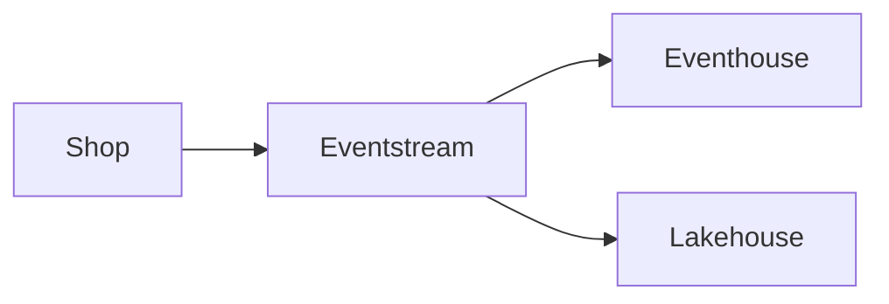

---
tags:
  - flashcards/dp700
---
# Eventstream

> [!tip] Do this
> Watch the video, then do the lab.

## Why this exists

Eventstream moves events from a source to several destinations without code.

## §1 Route events in flight

A shop sends click events to an eventstream. The eventstream sends each event to an eventhouse and to a lakehouse at the same time.



> **Quick check:** Which item sends one stream to several destinations?
> A. Eventhouse
> B. Eventstream
> C. Lakehouse
> D. Notebook

> [!question]- Answer
> **Answer: B** The eventstream routes events in flight.

## §2 Grant access to a schema

> [!example]- Code drill (T-SQL)
> Complete the statement that gives read access to the whole schema.
> ```sql
> GRANT SELECT ON ____::Sales TO analyst;
> ```
> > [!example]- Solution
> > ```sql
> > GRANT SELECT ON SCHEMA::Sales TO analyst;
> > ```

## Eventstream (card)

| Field | |
|---|---|
| What it is | Routes events in flight |
| Use it when | One stream needs several destinations |
| Not when | You must query the history → use an eventhouse instead |
| Key facts | No code is necessary |
| Docs | Learn page · search words: "eventstream overview" |

Route events to several destinations in flight;;Eventstream
Store and query streaming data with KQL;;Eventhouse
<!--SR:!2026-11-20,1,250-->
